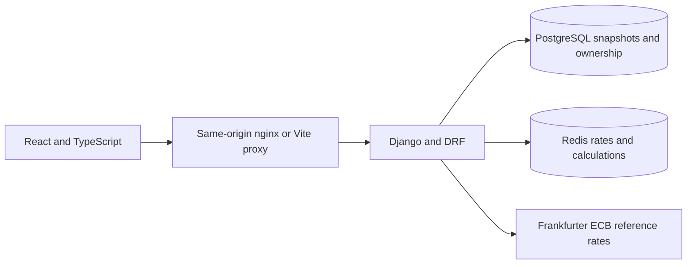

# QuoteGuard

**IMAP Topic 6 — Redis Caching and Cache Invalidation.** A Django and React quotation workspace for freelancers who enter INR costs and bill international clients. Redis caches reference-rate lookups and draft calculations; versioned keys prevent reuse after inputs or the source rate change. Finalised quotations are immutable PostgreSQL snapshots.

## Team responsibilities

| Member | Responsibility |
|---|---|
| Kanishk Thakkar | Core backend, Decimal pricing, Redis behavior, authentication, data integrity and integration |
| Dhruvil Shah | Frontend workflows, Cache Lab, conflict recovery and screenshots |
| Aarav Sheth | Browser regression tests, HTTP benchmarks, load/outage checks and evidence |
| Sai Sankhe | Docker setup, documentation, research explanations and demonstration |

These are responsibility assignments. The handoff packages contain AI-assisted work and inherited project files; each member must review, understand and verify their files before making genuine commits. One repository is used for the final group submission. No individual authorship is inferred from this table.

## Architecture



Authoritative prices use Python Decimal, never frontend arithmetic. For cost C, margin m, fee fraction f, fixed fee F and exchange rate r (billing units per INR), the suggested billing amount is `(r*C/(1-m)+F)/(1-f)`, rounded upward to the currency's minor unit. Margin is profit divided by net revenue. Taxes are not calculated; reference rates are not settlement guarantees. Nonpositive revenue has an undefined margin.

## Run locally

Prerequisites: Docker with Compose v2. Clone the shared repository and run these commands from its root.

```sh
cp .env.example .env
sh scripts/run.sh
```

Open the address printed by the script (default [localhost port 8780](http://127.0.0.1:8780)). Synthetic demo credentials are `demo` / `DemoQuoteGuard!2026`; `demo_other` uses the same demo password. The seed command does not replace existing passwords. Set `WEB_PORT` and `COMPOSE_PROJECT_NAME` in `.env` if another stack is running. PostgreSQL and Redis are private by default; web binds only to loopback.

`docker compose stop` stops this stack and preserves its data. `docker compose up -d --wait` resumes it. Avoid `down -v` unless intentionally discarding the local database.

## Screenshots

Actual browser captures with synthetic business records and the original recorded INR/USD provider response. These images are included in Dhruvil's package; they are not mockups or current market-rate observations.


## Research answers

### Cache hit versus miss

A hit means the lookup finds a valid stored result under the exact key. A miss means work must be performed to obtain that result. A miss need not cause an upstream request: another worker may populate the key while this request waits for its lock. QuoteGuard records both misses and provider attempts rather than treating them as identical.

### TTL and why invalidation is hard

TTL is the remaining lifetime of a cached value. Expiry removes it even if the source has not changed. Latest rates use a one-hour TTL, historical rates seven days and calculations fifteen minutes. Those are freshness/overhead choices, not a guarantee about publication schedules.

Invalidation is difficult because data dependencies and concurrent writers must agree. A quote's costs, target, fees and reference rate may change while an old calculation is still running. QuoteGuard uses quote/input and rate versions in its keys. An old key is no longer addressed after a version change; it physically expires later. A conditional database update and final rate-version check reject detected in-flight changes with HTTP 409. Finalised snapshots stay fixed. A change occurring after a request's final check must be observed by a subsequent request; no claim of instantaneous global freshness is made.

### Django per-view versus low-level caching

Django's `cache_page` caches a view response for a specified timeout. Its low-level `django.core.cache` API lets code cache individual values with explicit keys and timeouts. QuoteGuard uses direct redis-py calls for value-level caching and owned locks, rather than configuring Django's cache backend or decorating authenticated views. Caching an owner-specific response without all relevant identity and version inputs could expose data or return stale values. See the [Django 5.2 cache framework documentation](https://docs.djangoproject.com/en/5.2/topics/cache/).

The team should explain these answers in its own words during the demonstration and relate them to `rates.py`, `services.py` and the tests.

## Verification and measurements

See [current verification](docs/team-verification.md), [architecture](docs/architecture.md) and [the demo script](docs/demo-script.md). Historical verification files describe earlier runs and must not be presented as new measurements.

The HTTP benchmark uses the same authenticated endpoint, quote and request data in uncached, cold and warm conditions. It substitutes the hash-verified original Frankfurter response inside two local server processes. It makes no public upstream requests, adds no delay, and reports raw samples separately from warmups. These timings describe local HTTP with a recorded upstream, not live Frankfurter network latency.

Run backend tests on dedicated local infrastructure:

```sh
docker compose -f compose.yaml -f compose.test.yaml up -d --wait db redis
uv sync --frozen
DATABASE_PORT=55432 REDIS_URL=redis://127.0.0.1:56379/0 uv run pytest -q
cd frontend
npm ci
npm run build
npx playwright install chromium
QUOTEGUARD_BASE_URL=http://127.0.0.1:8780 npm run test:e2e
```

For browser runs with zero live provider calls, use the recorded server setup in [testing instructions](docs/testing.md). `QUOTEGUARD_BROWSER_CHANNEL=chrome` selects installed Chrome. Set `QUOTEGUARD_OUTPUTS` and `QUOTEGUARD_WORK` to local output/work folders outside the checkout. Defaults are sibling `outputs/` and `work/` folders.

## Recovery and limits

- A 409 conflict means the quote changed; use **Reload latest draft**. While editing, **Discard edits and reload** explicitly drops unsaved changes.
- A failed provider request produces an error without invented rates. Redis failure permits bounded direct provider work; no stale fallback is implied.
- The demo accounts, settings and passwords are local only. Before deployment, replace secrets, disable DEBUG, configure hosts, HTTPS and secure cookies.
- Never load test a public API. Load checks are loopback-only; the outage check requires an explicit local Redis container and verifies its published port before stopping it.
- Use free services only. Keep `.env`, credentials, dependencies, caches and generated test artifacts out of commits.
