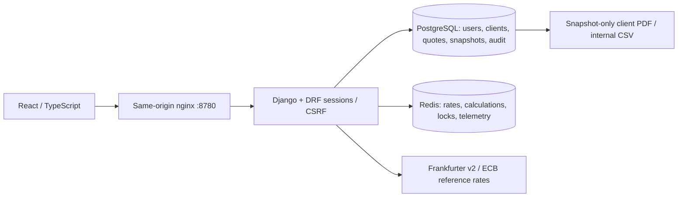

# Architecture & cache design

A single modular Django application owns pricing, rates, data and exports. PostgreSQL constraints validate monetary domains; row locks serialize draft edits and finalisation. PostgreSQL triggers reject modifications and deletion of finalised quotes and their costs. Finalisation fetches/calculates before opening its transaction, locks the row and checks the expected version, then stores a snapshot of client label, inputs, rate provenance, calculation version and results. Client edits never rewrite that snapshot.

Keys:

| Namespace | Contents | Lifetime |
|---|---|---|
| `qg:rate:frankfurter-ecb:HOME:BILLING:DATE` | Normalized pair and requested ISO date or `latest`; UUID rate version and original response evidence | Latest 3600s; historical 604800s |
| Rate key + `:lock` | Unique owner token | 6s; acquisition wait ≤1.5s |
| `qg:calc:USER:QUOTE:INPUT_VERSION:RATE_VERSION:CALC_VERSION:HASH` | Decimal results and fixed-price scenarios; hash covers all calculation inputs | 900s |
| `qg:metrics:USER` | Rate hits, misses, upstream attempts, calculation hits/misses, last duration | 24h, refreshed by activity |
| `qg:lab:USER:CURRENCY` | Owner-isolated cold/warm response | 60s |
| `qg:lab:USER:expiry` | Clearly synthetic expiry experiment | 3s |
| `qg:benchmark:*` | Recorded-response controlled experiments | Explicitly removed after experiment; otherwise bounded TTL |

Shared reference-rate cache entries have no personal data. Draft calculation keys include the owner ID. API querysets and client assignment enforce ownership on every operation. Tests use Redis database 15; normal application uses 0, so running tests cannot contaminate the live workspace. Benchmark keys use their own namespace.

Input mutations happen transactionally and advance the quote version. Invalidation events are registered with `on_commit`. Changes do not delete whole key families: newer work addresses a different key, and prior entries expire. Refresh stores a new rate version only after a successful provider response and database persistence. A Lua compare-and-publish also verifies lock ownership atomically; a delayed worker whose lease expired cannot overwrite a newer cached rate. Failure leaves the previous key intact but returns an explicit error to the requester. No stale fallback is silently served. In-flight old calculations cannot become the current draft result: their quote-version predicate fails after an input edit.

No external call is made for identical currencies. Dates requested in the future are rejected. A prior available rate date returned by the provider is retained and labelled. The source URL, response bytes as text, SHA-256, request date, actual date and fetch time are recorded for finalised versions. Fees are estimates, and no tax rules are introduced.

Tradeoffs: caching these small Decimal calculations is educational and can cost more than recomputing them, while rate caching avoids provider requests and database writes. Lock waiters may receive a busy error if work exceeds the wait bound. Redis outage degrades to bounded direct requests; production systems need rate limiting/circuit breakers. TTLs bound orphan retention. Audit and rate snapshots currently need an operational retention policy for long-lived deployments. All services are local; this is not a publicly deployed product.

## Team delivery refinements

The calculate, scenario and finalise paths return HTTP 409 when a concurrent input change or changed rate version is detected. The interface exposes an explicit reload action and does not silently retry a mutation. A version check is an observation boundary; changes after that boundary are detected on later reads.

The recorded benchmark server is a localhost-only management command with separate database/Redis guards. Its provider replacement runs inside the server process. Uncached mode bypasses rate/calculation value storage while retaining normal authentication, persistence, locks and metrics. The benchmark client measures actual HTTP round trips; Cache Lab labels its own server timings separately. Neither mode injects artificial delay.

Vite preserves the browser's Host header for same-origin CSRF checks. nginx forwards the browser host in Compose. Web/database/Redis host ports are configurable; the database and Redis are only published by the explicit test override, always on loopback.
